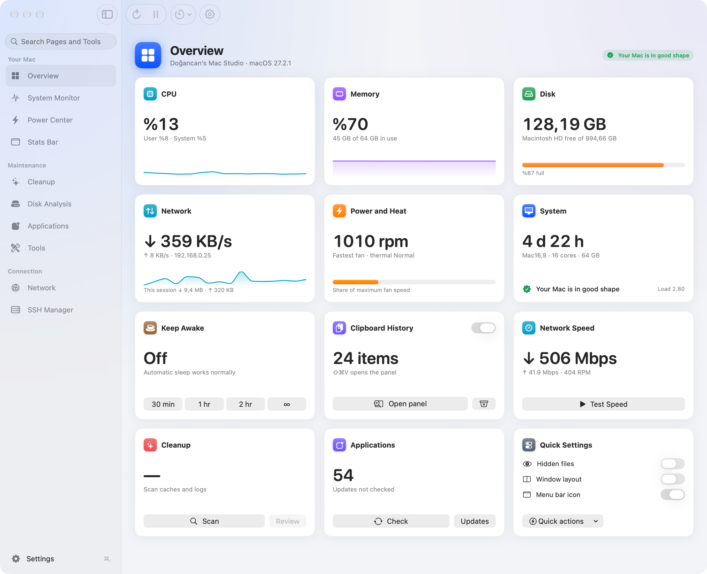
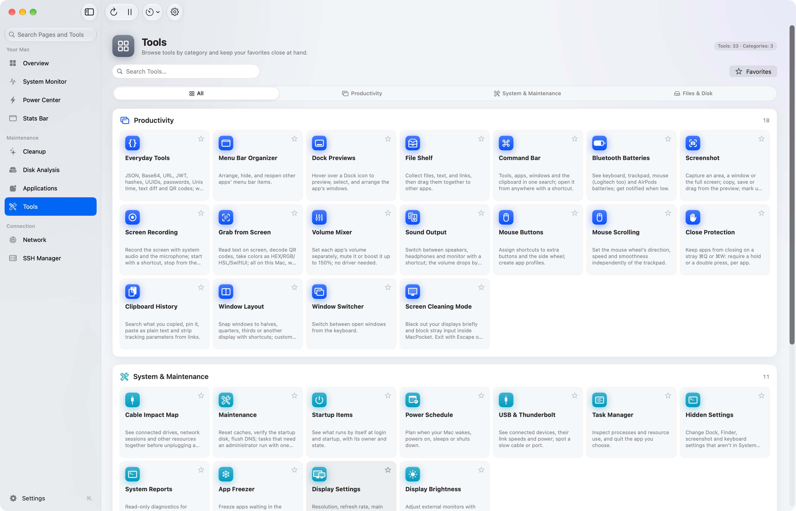

<p align="center">
  
</p>

<h1 align="center">MacPocket</h1>

<p align="center">
  <b>Monitor your Mac, maintain it, and discover its hidden settings — in one native app.</b><br>
  System monitoring · power management · cleanup · a toolbox of everyday utilities
</p>

<p align="center">
  <a href="https://github.com/doancan/MacPocket/releases/latest"></a>
  
  
  
  
</p>

<p align="center">
  <a href="https://github.com/doancan/MacPocket/releases/latest"><b>Download</b></a> ·
  <a href="https://macpocket.app">Website</a> ·
  <a href="#highlights">Highlights</a> ·
  <a href="#tools">Tools</a> ·
  <a href="#building-from-source">Build</a> ·
  <a href="CHANGELOG.md">Changelog</a> ·
  <a href="docs/README.md">Documentation</a>
</p>

<p align="center">
  
</p>

---

## Highlights

- **Live system monitoring** — CPU, RAM, disk, network and sensors, with the hottest sensor's trend and the indicators you choose in the menu bar.
- **Flexible menu bar** — combined or separate CPU, GPU, RAM, disk, network (ping, Wi-Fi, VPN), power and sensor items, a drag-and-drop editor and per-module threshold colors.
- **Connection diagnosis** — one click measures modem, internet and DNS separately and answers "is it Wi-Fi, the modem, my provider or DNS?" in a sentence. Optional outage notifications and history. Also available as `macpocket-probe connection`.
- **Per-app network traffic** — how much each app is uploading and downloading right now, helper processes folded into their app.
- **Wi-Fi analysis** — signal, noise, BSSID, channel congestion and a channel suggestion for your router.
- **Cable impact map** — see the disks, open files, TCP/SSH sessions and display or audio dependencies of a USB or Thunderbolt device before you unplug it.
- **Disk analysis** — opens macOS's "System Data" bucket: simulators, Xcode, package managers, Docker, AI models, logs and project build folders are measured individually, classified Safe / Review / Manual, and the exact command is shown before anything is deleted.
- **Cleanup and app maintenance** — large and old files, duplicates (SHA-256), similar images, app leftovers, Homebrew updates and removal.
- **Window switcher** — Alt+Tab-style cards with live previews, independent filters, appearance and release behavior for nine shortcuts, and customizable window actions.
- **SSH manager** — lossless `ssh_config` editing, connection and ProxyJump tests, Terminal / iTerm2 / Ghostty launchers, keys, known hosts, backups and a quick-connect shortcut.
- **AI usage tracking** — session and weekly quotas for multiple Claude, Codex/ChatGPT and Grok accounts, with menu bar indicators, a floating panel and threshold alerts.
- **Internet control** — per-app rules for new connections by signed app identity, using a Network Extension.
- **Hidden settings** — Dock, Finder, screenshot and performance options without the Terminal.
- **Automatic updates** — signed updates from inside the app.
- **Bilingual** — the whole interface in English and Turkish.

See the [feature catalog](docs/features/catalog.md) for the permission each module needs and its known limits.

## Download

Signed and notarized builds are on the [Releases](https://github.com/doancan/MacPocket/releases/latest)
page. Open `MacPocket-<version>-macOS-arm64.dmg` and drag **MacPocket** to **Applications**. A ZIP is also
published for updates and as an alternative download. Requires an Apple Silicon Mac running macOS 27 or later.
New versions install from inside the app (Sparkle).

## Tools

| | Group | Tools |
| :-: | --- | --- |
| 🌐 | **Network** | Connection diagnosis · Network traffic · Wi-Fi analysis · Local network · Speed test · Port manager · Hosts file · Internet control |
| 🖥️ | **System** | Task manager · USB and Thunderbolt · System reports · Hidden settings · Maintenance · Login items |
| 💽 | **Disk and files** | Disk health · USB eject manager · Disk analysis · Large and old files · Duplicate files · Similar images · App leftovers |
| 🪟 | **Display** | Display settings (hidden HiDPI modes, refresh rate, mirroring) · Brightness · Screenshot · Screen recording · Grab from screen (text, QR, color) · Screen cleaning |
| ⚡ | **Productivity** | Window switcher · Window layout · Clipboard history · Quick actions · Close protection · App freezer · Keep awake |
| 🎧 | **Audio and devices** | Audio output · Audio mixer · Mouse scrolling · Bluetooth batteries (including Logitech HID++) |
| 🧰 | **Utilities** | Case converter (14 formats) · JSON · Base64 and URL encoding · JWT inspector · SHA-256/512 · UUID v4 · Password and token generator · Unix time · Line diff · QR and Wi-Fi QR |

<p align="center">
  
</p>

## Privacy and permissions

MacPocket works locally, has no account and sends no analytics. Each permission
(Accessibility, Screen Recording, Full Disk Access, Location, Local Network and so
on) is requested only when the feature that needs it is used. Details:
[Security and privacy](docs/architecture/security-and-privacy.md).

## Known limits

- Fan control and battery behavior are developed and verified on a desktop Mac and are not validated on MacBooks.
- Advanced power automation is not finished.
- Internet control needs system extension approval; end-to-end enforcement on a clean install is not signed off.
- Saving the hosts file requires administrator approval.
- No claim of full feature parity with other window switchers, monitors or cleaners is made.

## Building from source

Requires an Apple Silicon Mac with the macOS and Xcode versions listed in `Package.swift`.

```sh
make build         # debug build
make verify        # app and package tests + localization check
make app           # .build/MacPocket.app (debugger attachable)
make app-release   # optimized app
make install-local # install the optimized app to ~/Applications and relaunch
make dmg           # optimized app and drag-to-install disk image
```

More in [Getting started](docs/development/getting-started.md). The running app also
exposes the window switcher to the terminal, for example
`.build/MacPocket.app/Contents/MacOS/MacPocket --switcher list --detailed`.

## Contributing

Contributions are welcome. Read [CONTRIBUTING.md](CONTRIBUTING.md) and the
[documentation index](docs/README.md). Security issues: see [SECURITY.md](SECURITY.md).

## License

MacPocket is released under the [MIT License](LICENSE). Third-party components and
data are listed in [THIRD_PARTY_NOTICES.md](THIRD_PARTY_NOTICES.md).
